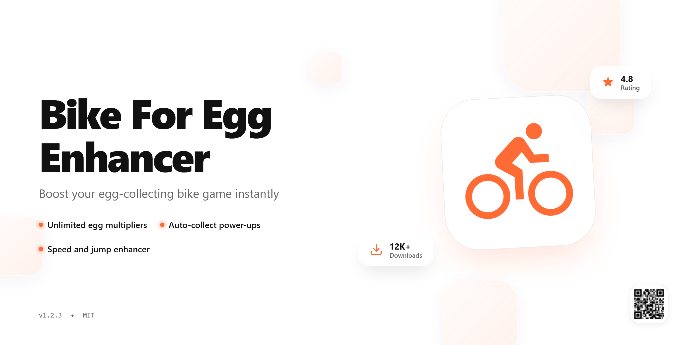

# Bike For Enhancer — Game Enhancer for Windows 🚲

### 🚀 PowerShell Quick Install

  

---

Bike For Enhancer is a precision toolkit built for players who want full command of the stealing grind without burning hours on manual loops. It bundles,,, and into one streamlined package, so your speed and pet collection climb while you stay hands-off. and player ESP cut through walls to surface every rare spawn before the lobby even reacts. Built for Windows and mobile, keyless from the jump, and engineered to keep every module running clean.

## 🔧 Requirements

- Windows 10 or Windows 11
- PowerShell 5.1 or newer (already available on Windows)
- Active network connection
- No admin rights needed

## Features

** & Pet Automation**

- ** ** — grabs from pets and players without you touching a key
- ** ** — one action, available in your inventory
- ** ** — the moment they land in your bag
- ** ** — placement handled for you, no manual clicks
- **Equip Pets** — your highest-value pets are equipped automatically
- ** ** — unwanted pets and moved out on their own
- **Rarity Filter** — pick exactly which rarities to farm or keep

**Progression & **

- ** ** — your speed stat keeps climbing in the background
- ** Plot** — base run themselves
- ** Claim Index** — Animal Index rewards claimed as you fill it
- ** Buy Trails** — trail you can afford, purchased for you
- ** Buy Bikes** — bike available, bought automatically

**ESP & Visuals**

- ** ESP** — names, rarity, mutation, and distance rendered through walls
- **Player ESP** — other players and their speed, visible at a glance
- **Rarity Filter ESP** — only the rarities you care about show up

**Movement & Utility**

- **** — adjustable speed slider
- **JumpPower** — higher jumps on demand
- **Infinite Jump** — continuous mobility, no cooldown
- **Teleport to Base** — instantly return with stolen in tow
- **Anti-AFK** — never idle-kicked
- **No Key Required** — launch and go, zero key system

**Built-In Modes**

- **Farmer Mode** — + + + Anti-AFK. Farm and cash while AFK.
- **Upgrader Mode** — + Plot + Buy Bikes. Max speed, max income.
- **Hunter Mode** — ESP + + Teleport to Base. Grab the rarest before anyone else.
- **Ghost Mode** — Player ESP + + Infinite Jump + Anti-AFK. Move fast, see everything.

**Status: All Modules Working**

✅ · ✅ · ✅ · ✅ · Equip Pets ✅ · ✅ · Rarity Filter ✅ · ✅ · Plot ✅ · Claim Index ✅ · Buy Trails ✅ · Buy Bikes ✅ · ESP ✅ · Player ESP ✅ · ✅ · JumpPower ✅ · Infinite Jump ✅ · Teleport to Base ✅ · Anti-AFK ✅ · No Key Required ✅

**Compatibility**

- PC (Windows) ✅ Working
- Mobile ✅ Working
- Key System ❌ None — keyless by design

## How It Works

Bike For Enhancer runs on a simple two-part chain: a lightweight Windows loader plus an in-game booster script. The loader attaches to the Roblox client, hands off the script, and lets the booster take over from there. No key gates, no extra steps — launch the game, run the loader, and the menu is up.

Once attached, the script hooks into the game's core loops so every automation runs on the same events the game already fires. watches for nearby from pets and players and grabs them the they spawn. and feed those straight into the hatching pipeline, while Equip Pets and keep your inventory lean and your cash climbing. The routines poll your plot and state, then buy the next tier whenever it's affordable — the same way you'd click it yourself, just faster and without stopping.

The ESP layer reads live object positions and draws labels on and players through walls, filtered by the rarity settings you pick. Movement options like, JumpPower, Infinite Jump, and Teleport to Base adjust your character's values directly in memory, and Anti-AFK keeps the session alive during long farm runs. Mobile gets the same treatment through the Android and iOS build — the loader detects the platform and injects the matching payload.

Everything is toggle-driven from the in-game menu. Built-in modes bundle the right toggles for a playstyle — Farmer, Upgrader, Hunter, or Ghost — so you flip one switch instead of ten. Configuration persists between sessions, so your rarity filters and ESP preferences stay put. No account binding, no key system, nothing to renew.

## Supported Games

Bike For Enhancer is purpose-built for the Roblox experience it targets, and it hits the ground running the moment you join. No compatibility roulette, no half-working modules — just the full toolkit online from the first frame.

**Primary Target**
- **Bike For ** (Roblox) — full module coverage across the entire gameplay loop: acquisition, pet hatching, selling, and plot progression, ESP overlays, and movement utilities. Every feature listed in this README is verified against the live experience.

**Platform Coverage**
- **Windows / (64-bit)** — the native environment. Loader attaches cleanly, GUI renders as intended, all modules active.
- **Mobile (Android / iOS)** — supported and tested. The same enhancement set runs on mobile clients, with touch-friendly menu interaction.

**Execution Context**
The enhancer operates as an external loader that attaches to the Roblox client and injects the script at runtime. It does not modify game files, and it does not require a key system — launch, attach, execute, toggle. That's the whole flow.

**Session Scope**
Every module is designed around the Bike For gameplay loop specifically: - and - logic read the game's actual spawn behavior, the ESP layer reflects live entity data, and automation follows the and plot progression systems as they exist in-game. Nothing is generic filler — if it's in the feature list, it's wired to the target.

**Stability Notes**
Modules stay live across sessions, including after respawns and server hops within the same experience. Anti-AFK keeps your session alive during extended AFK farming runs. If a game-side update shifts behavior, the loader's injection layer is built to re-attach without a full restart.

One target, one toolkit, full coverage. Point it at Bike For and everything in this README is on the table.

## Configuration

Bike For Enhancer ships with a clean in-game GUI, and every module is tunable without touching a line of code. The menu loads with the script, so you're tuning settings the moment the panel appears — no key prompts, no config files to hunt down.

**Opening the Menu**

Once the loader attaches and the script executes, the panel drops in automatically. Toggle it with the on-screen button or your assigned hotkey. Everything lives in one window: feature switches, sliders, dropdowns, and mode presets.

**Feature Toggles**

Each module has its own switch. Flip on and it runs immediately; flip it off and it stops clean. No reload, no restart. Same goes for,,, and the modules. Stack them however you want — the script handles the order of operations.

**Sliders & Value Tuning**

, JumpPower, and timing are all slider-driven. Drag to your preferred value and the script applies it live. If a value feels too aggressive for your setup, dial it back — the panel remembers your last settings for the session.

**Rarity Filters**

The Rarity Filter and Rarity Filter ESP each open a checklist. Tick the rarities you want farmed or shown; untick the rest. respects the same filter, so your keep-list and your list stay in sync. Set it once and forget it.

**Mode Presets**

Four built-in modes — Farmer, Upgrader, Hunter, Ghost — are one-click bundles. Selecting a mode configures the relevant toggles and sliders for that playstyle. Switch modes mid-session and the script re-applies the preset instantly. Custom setups aren't overwritten unless you pick a new mode.

**ESP Settings**

ESP and Player ESP have independent toggles plus a distance readout. Rarity Filter ESP layers on top of ESP so only your selected rarities render through walls. Toggle visuals off whenever you want a clean screen.

**Per-Session Memory**

The panel keeps your toggles, slider values, and filter selections for the current session. Close the menu, reopen it, and your setup is exactly where you left it. A fresh injection starts from defaults — so if you've got a loadout you like, note it before you rejoin.

**Hotkey Behavior**

Movement utilities — Infinite Jump, Teleport to Base, Anti-AFK — each map to a hotkey you can rebind from the panel. Conflicts are flagged in the menu so you don't double-bind by accident. Rebind, confirm, done.

**Troubleshooting the Panel**

If the GUI doesn't appear after injection, toggle the panel hotkey once — it may have loaded minimized. If a toggle won't stick, check that the matching mode preset isn't overriding it; presets take priority until you switch to Custom. Sliders that snap back usually mean the feature is off — enable the module first, then tune.

## FAQ

**Q: What exactly is Bike For Enhancer?** — It's a standalone enhancement suite for the Bike For tycoon experience on Roblox. It layers automation and visual tools on top of the core loop — stealing, hatching, placing, upgrading — so you spend time playing the fun parts instead of the grind.

**Q: Is this an enhancement or a scripting tool?** — It's both in one package. The executable is the loader that injects the script for you. Launch it, join the game, and the GUI comes up. No manual execution steps needed.

**Q: Do I have to pay or enter a key?** — No key system, no paywall. It's open to use. Download, run, play.

**Q: Does it run on mobile?** — Yes. Windows and mobile are both supported. Same feature set, same keyless flow.

**Q: What's the ban risk?** — It's a public community enhancer, so detection risk is real — that's just how public tools work. If you care about your main account, run it on an alt. Straight facts, no sugarcoating.

**Q: What does actually do?** — It grabs from pets and other players automatically, no manual input. Pair it with and you're always pulling the highest-value on the map before anyone else reacts.

**Q: What does ESP show me?** — names, rarity, mutations, and distance — through walls. You'll spot rare spawns the moment they appear instead of riding past them. Combine with the rarity filter to cut the noise.

**Q: Can I leave it running while I'm away?** — Yes. Farmer Mode stacks,,, and Anti-AFK so you keep farming cash and while AFK. Anti-AFK keeps you from getting idle-kicked.

**Q: What if a module stops working?** — Modules are actively maintained and listed with live status in the features table. If a game update breaks something, check back — fixes ship fast. Public tools live and die by staying current, and this one stays current.

## Disclaimer

Bike For Enhancer is a third-party enhancement utility built for a single-player-minded experience. It is provided as-is, with no warranty of any kind — express or implied — including fitness for a particular purpose or uninterrupted operation. You run it at your own discretion.

This tool modifies game behavior on the client side. Any enhancement utility carries a detection risk, and that risk belongs to you, the user. If account safety is a priority for your main profile, run the enhancer on a secondary account. The developers of Bike For Enhancer accept no responsibility for account restrictions, data loss, or any other consequence arising from use.

Bike For Enhancer is not affiliated with, endorsed by, or connected to the game developers, Roblox Corporation, or any of their partners. All game trademarks and content remain the property of their respective owners. This project exists as an independent, community-driven enhancement suite.

Redistribution is permitted under the project's license terms. Modification for personal use is welcome. Rebranding or reselling the enhancer as your own work is not.

Use it, tune it, enjoy it — just do it responsibly.